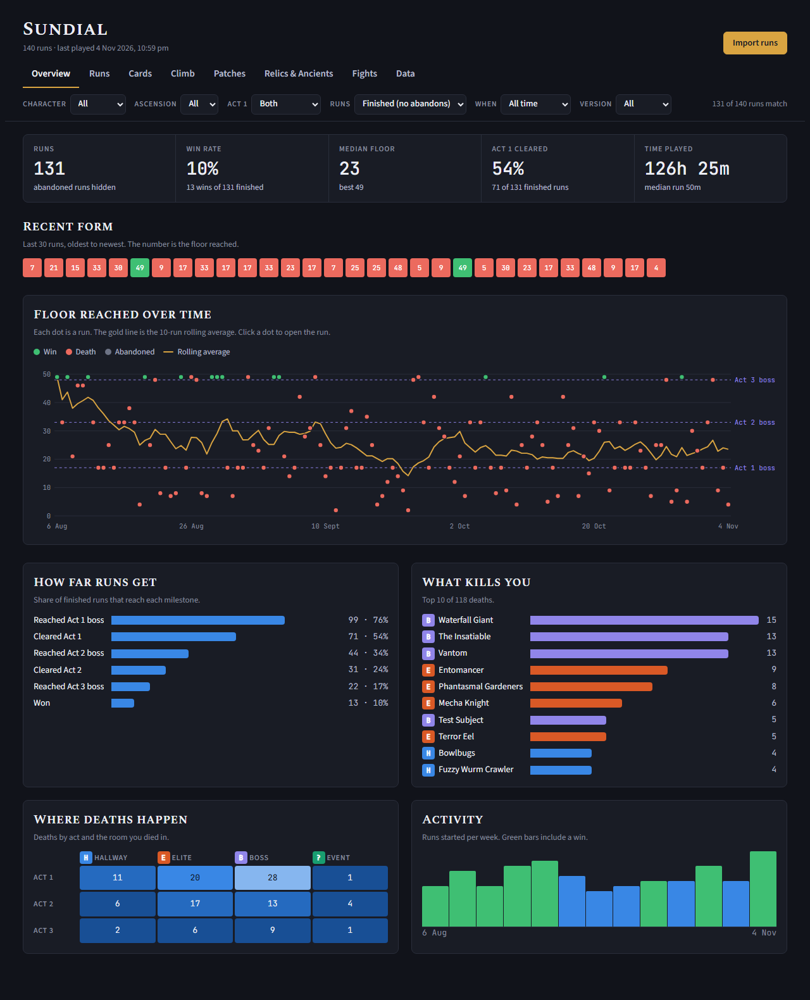
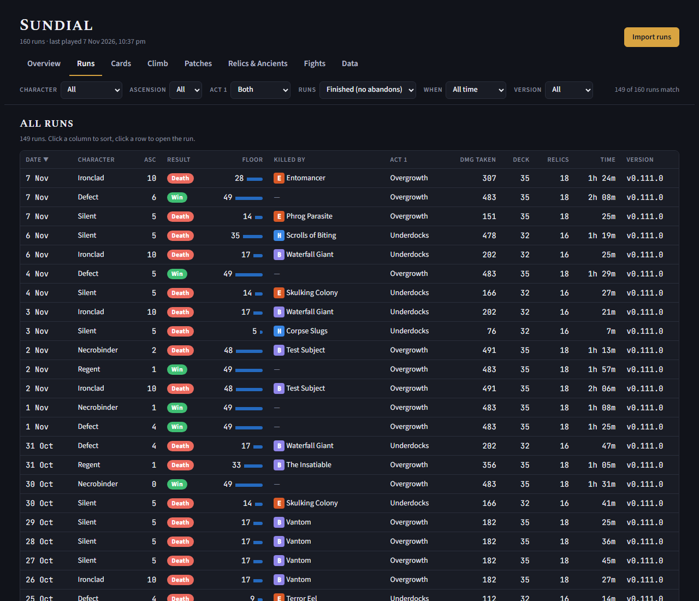
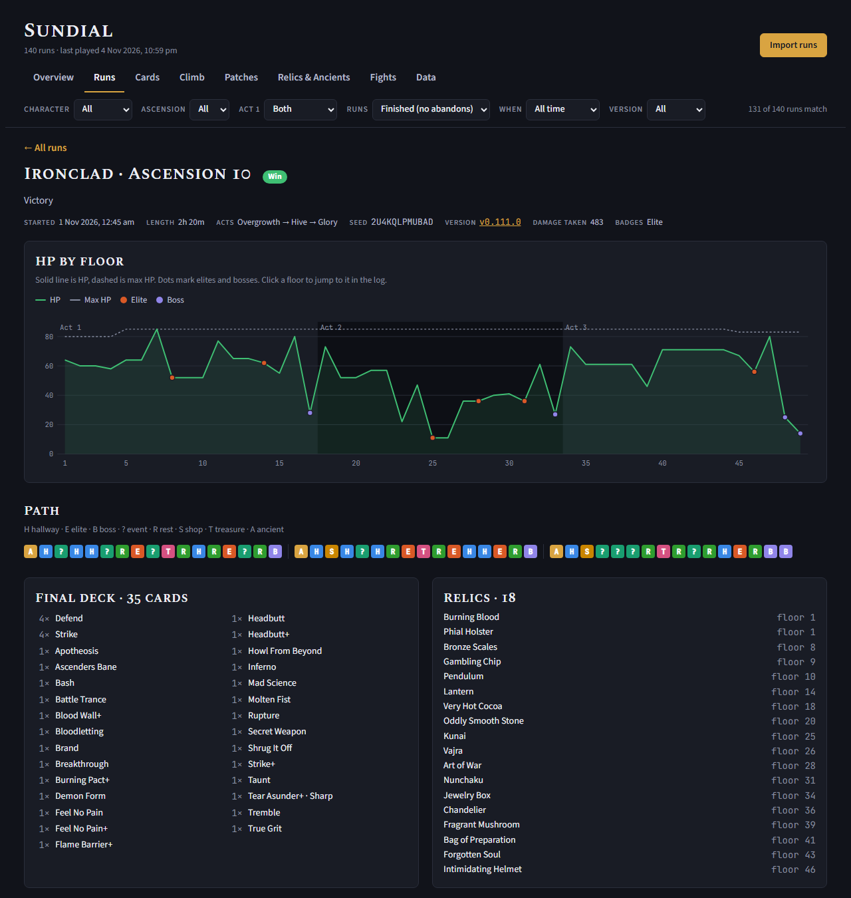
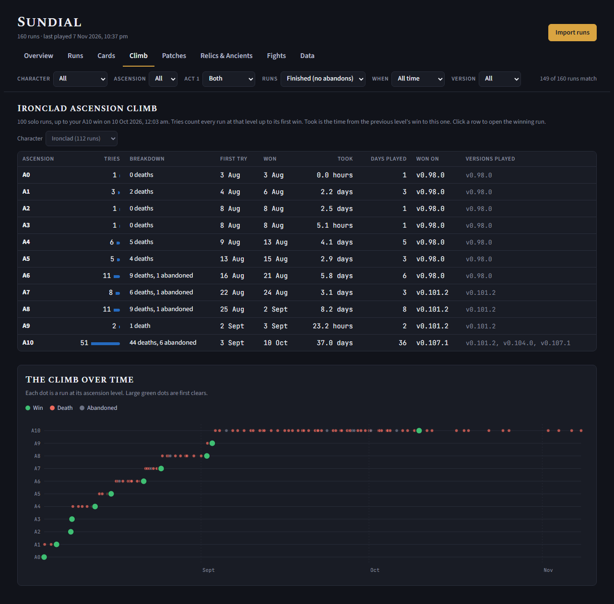
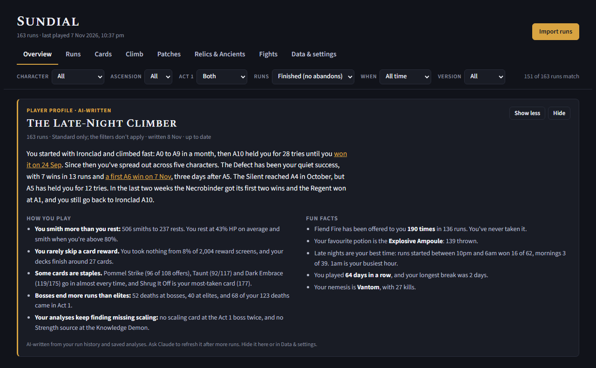
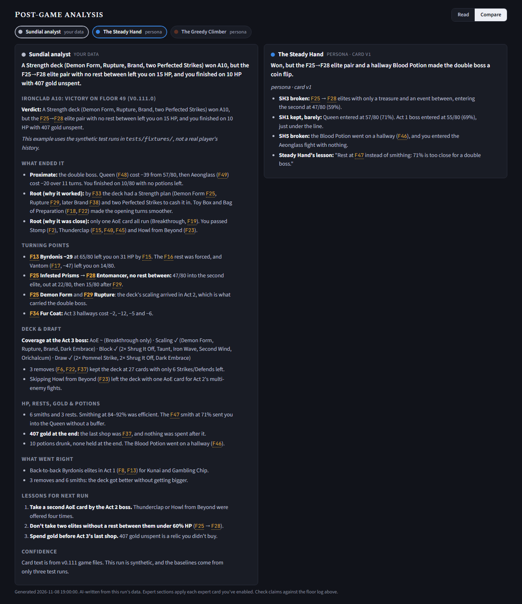

# Sundial

*Every run leaves a shadow.* Sundial is a **run ledger** for Slay the Spire 2: it turns your run history into
something you can actually read. Every run in one sortable list, the full floor-by-floor story of each one, and
charts of how you're climbing. That's what Sundial is for.

There's also an optional side experiment: an AI post-game analysis that reads a run alongside the game's own data
and your history. It's a thought exercise in how far AI can take this, kept separate so the ledger never depends
on it. See [AI post-game analysis](#optional-ai-post-game-analysis-a-side-experiment).

> Unofficial fan project, not affiliated with or endorsed by Mega Crit. A weekend project, built with AI, to help
> me get better at the game. Provided as is, with no warranty (see [Licence](#licence)).



<sub>Screenshots use generated demo data, not a real player's history.</sub>

**Try it in your browser, no install:**
- [**Run tracker demo**](https://ducops.github.io/sundial-sts2/web/dist/sundial-demo.html): 163 generated runs, the dashboard on its own.
- [**Analysts demo**](https://ducops.github.io/sundial-sts2/web/dist/sundial-demo-analysts.html#run-K2VQJ6P8KWV1-1794051437): the same runs, with AI post-game
  analyses of the 10 most recent, compared side by side with three expert viewpoints (one a custom card written
  for the demo).

<sub>Both demos use generated runs, not a real player's history. Your own runs stay in your browser; see
[Quick start](#quick-start-the-dashboard).</sub>

## What's new in 0.2.0

**Player profile** (optional, with the AI side). Ask Claude *"write my player profile"* and it writes a short
portrait of how you play, across every run, mode and character: a title, your story so far (climbs, firsts, what's
new), your play style and a few fun facts, linked to the runs that mattered. It sits at the top of the overview
whatever the filters, says how many runs you've played since it was written, and can be collapsed or hidden. If you
don't use the AI side, nothing changes.

See it in the [analysts demo](https://ducops.github.io/sundial-sts2/web/dist/sundial-demo-analysts.html#overview), or
[set up the AI side](#optional-ai-post-game-analysis-a-side-experiment). Every release is in the [changelog](CHANGELOG.md).

## Why

I came to Slay the Spire late, and StS2 arrived just as I fell for it. I'd been playing Early Access for months
but ended up stuck on A10 Ironclad. I kept opening the in-game run history and not finding what I wanted: which
fights keep killing me, how long each ascension took, what I picked and skipped, which patch a run was on.

I play across a PC, a Steam Machine and an Ayn Thor, and every run is saved locally as a file. What if there was
some way to read those files so I could review them on a webpage? Introducing Sundial. It reads those files and
shows them the way I wanted to see them.

## What it does

**Run ledger and dashboard** (the main thing; no install, nothing uploaded):
- **Overview:** win rate, deaths by room and killer, activity over time, per character and ascension.
- **Runs:** every run in one sortable, filterable table. Open any run for its HP chart, path, deck, relics and a
  floor-by-floor log of picks, skips, rests, shops, potions and damage.
- **Climb:** how many attempts and days each ascension took, run by run.
- **Patches:** which early-access version each run was played on, with first clears per version.
- **Cards, Relics & Ancients, Fights:** pick rates, win rates and your damage against each encounter.
- Merge runs from several devices: re-import any time and only new runs are added.

| Runs | Run detail | Climb |
|---|---|---|
| [](docs/images/runs.png) | [](docs/images/run-detail.png) | [](docs/images/climb.png) |

**A permanent archive** (optional, with the Python package): the game prunes old runs, so the archive keeps a copy
of every run it sees.

**AI post-game analysis** (optional side experiment): if you use Claude or another MCP client, the AI can read a
run and write up what decided it, using the game's own data and your history as the baseline. You can add
**experts**, viewpoints you write yourself, for extra takes on each run. Skip it entirely if AI isn't your thing;
nothing else depends on it.

## Project status

**Run ledger: complete.** This is the project. Reading run history, the dashboard, per-run views and trends do what I
set out to build, and it keeps working without anything else installed.

**AI post-game analysis: a thought experiment, evolving.** I wanted to see where AI could take post-game review if
it worked from facts instead of guesses. Its understanding of the game comes from:

- the game's own files on your machine: every card, relic, potion, character, monster, encounter, act and event,
  with real numbers per ascension, rebuilt after each patch
- your own runs, as the baseline for what's normal for you
- a small hand-written layer: archetype definitions, card annotations and character notes (mostly Ironclad so far,
  Silent in progress)

So it's strongest on facts and your own data, and thinnest where it has to interpret. Card annotations marked
`draft` haven't been reviewed by someone who knows that card well, and the analysis says so when it relies on them.

## Quick start: the dashboard

1. Open `web/dist/sundial-blank.html` in a browser.
2. Click **Import runs** and choose your runs: the `history` folder, a few `.run` files, or a zipped saves folder.
3. Runs are saved in that browser, so next time just open the page. Import again after new runs.

Where to find your runs:

| Device | Where |
|---|---|
| Windows PC | `%APPDATA%\SlayTheSpire2\steam\<SteamID>\profileN\saves\history` |
| Steam Cloud copy (Windows) | `C:\Program Files (x86)\Steam\userdata\<id>\2868840\remote\` |
| Steam Machine / Steam Deck / Linux | Not verified yet. Steam Cloud usually syncs these runs to your PC, so importing on the PC covers them. |
| Android handheld (e.g. Ayn Thor via GameNative) | Export the game's saves as a zip and import the zip. |

The game only keeps your recent runs in `history`, so import regularly (or use the archive below).

## Optional: permanent archive

The game only keeps your recent runs. The Python package keeps a copy of every run it sees in
`~/.sundial-sts2/archive`, never pruned. It needs Python 3.11+ via [uv](https://docs.astral.sh/uv/)
(`winget install astral-sh.uv`): put this folder somewhere permanent and run `uv sync`. The archive is filled on
every tool call of the MCP server (below); import `~/.sundial-sts2/archive` into the dashboard like any other folder.

It also scans Steam Cloud's local copy (`Steam\userdata\<id>\2868840\remote`), so runs played on another device
show up even before you launch the game on this PC.

| Setting (env var) | Default |
|---|---|
| `STS2_SAVE_ROOT` | `%APPDATA%\SlayTheSpire2` (macOS `~/Library/Application Support/SlayTheSpire2`) |
| `STS2_STEAM_CLOUD` | `1`: also scan `Steam/userdata/*/2868840/remote`. Set `0` to turn it off |
| `STS2_EXTRA_DIRS` | none. Extra folders separated by `;`, e.g. an unzipped phone/GameNative export |
| `STS2_GAME_DIR` | found via Steam. The game install folder used to build game facts |
| `STS2_AUTO_KNOWLEDGE` | `1`: build/rebuild game facts automatically. Set `0` to turn it off |
| `STS2_ARCHIVE` | `~/.sundial-sts2/archive` |
| `SUNDIAL_HOME` | `~/.sundial-sts2` (archive, experts, analyses, lessons, knowledge) |

Set them in the `"env": { ... }` block of the Claude Desktop config. Upgrading from the prototype
(`~/.spire-ledger`)? On first start Sundial copies it to `~/.sundial-sts2` once and leaves the old folder in place.

## Optional: AI post-game analysis (a side experiment)

A thought exercise: give an AI the game's own facts and your history, and see what it can tell you about a run.
The **Sundial analyst** describes what happened and what decided it, against your own baselines. **Experts**,
viewpoints you write yourself, add their own takes. How it all works, and how to change it, is in
**[the guide for tinkerers](docs/ai-analysis.md)**.

**Set up** (after `uv sync`):
1. Connect the MCP server to your AI client.
   - **Claude Code** (VS Code or terminal): open this folder. `.mcp.json` registers the server and
     `.claude/skills/` holds the analysis skill; approve the server when asked.
   - **Claude Desktop:** Settings → Developer → Edit Config, then add:
     ```json
     {
       "mcpServers": {
         "sundial-sts2": {
           "command": "uv",
           "args": ["--directory", "C:\\path\\to\\sundial-sts2", "run", "sundial-sts2"]
         }
       }
     }
     ```
     Restart Claude Desktop, then zip `.claude/skills/sundial-sts2-analyst` and upload it in Claude's skills
     settings.
2. Ask: *"analyse my latest run"*, *"why did I die last run?"*, *"what patterns do my A10 deaths have?"*
3. To see analyses in the dashboard, import your `~/.sundial-sts2` folder. Each one appears at the bottom of its
   run, with a toggle for each expert.
4. For fun, ask *"write my player profile"*: a short portrait of how you play across every run and mode, with a few
   fun facts. It shows at the top of the overview once imported, and you can hide it.



*A player profile written for the [analysts demo](https://ducops.github.io/sundial-sts2/web/dist/sundial-demo-analysts.html#overview)'s fake runs.*

**Game facts (automatic).** On first start, and after every game update, the server reads your own install and
builds what the analyst knows: cards, relics, potions, enchantments, powers and keywords; each character's starting
kit; monsters' HP and moves with their numbers per ascension; encounters, acts and events; and the official patch
notes. It takes a few seconds and lands in `~/.sundial-sts2/knowledge/game/`.

Nothing is downloaded and no game
data ships with Sundial; it's derived from the files on your machine, for your own use. It reads the game's
internal formats (`sts2.dll` via [dnfile](https://github.com/malwarefrank/dnfile), MIT), which Mega Crit can change
in any update, so it may break after a patch; if a build fails, the last good one keeps working and `status` says
why. Rebuild by hand: `uv run python tools/import_game_data.py ["<game folder>"]`.

**Experts.** Short cards you write, each a point of view on how to play. Every enabled expert gets its own section,
and the dashboard can toggle them or compare them side by side.



*The Sundial analyst and The Steady Hand reviewing the same run in Compare view (from the [example analysis](examples/analysis-1790200000.md)
of a synthetic test run). The analyst works from your own baselines; the expert cites its own principles (SH1, SH3, ...)
and the floors they apply to.*

Three examples ship in `experts/`: `steady-hand` (survival first), `greedy-climber` (elites and relics) and
`house-rules` (your own rulebook). Copy them to `~/.sundial-sts2/experts/`, then ask *"enable greedy-climber"* or
*"help me write an expert"*. Full guide: [docs/creating-an-expert.md](docs/creating-an-expert.md).

**Make it your own.** [The guide](docs/ai-analysis.md) explains each part (game facts, the knowledge layer of
roles, mechanics and archetypes, the analyst skill, experts), every section of the run summary, the schemas and
why they're built that way, and recipes for changing archetypes, card annotations, character notes, experts and
the report itself.

## Project layout

| Path | What it is |
|---|---|
| `web/` | The dashboard: `src/` (single-page app + JS parser), `build/`, `dist/sundial-blank.html` and the two demo builds |
| `src/sundial_sts2/` | Python package: `.run` parser, archive, game facts, analysis, MCP server |
| `knowledge/` | Hand-written archetypes and card annotations per character ([`SCHEMA.md`](knowledge/SCHEMA.md)), validator |
| `.claude/skills/sundial-sts2-analyst/` | The Sundial analyst skill |
| `experts/`, `docs/` | Example expert cards, [the AI analysis guide](docs/ai-analysis.md) and [writing an expert](docs/creating-an-expert.md) |
| `examples/` | A sample post-game analysis |
| `tests/` | Smoke test, pytest suite and three fixture runs (`uv run python tests/smoke.py`, `uv run python -m pytest`) |
| `tools/import_game_data.py` | Rebuild game facts from your install by hand (the server does it automatically) |
| `tools/import_community_data.py` | Optional: import older community card/relic/potion text (v0.98) for your own use |

## Troubleshooting

- **Windows on ARM:** if `uv sync` fails building a dependency, use x64 Python: `uv sync --python cpython-3.12-windows-x86_64-none`.
- **Claude doesn't see the tools:** check Claude Desktop's MCP logs (Settings → Developer) and that the path in `--directory` is right.
- `status` shows which folders are scanned, how many runs are archived, and which game facts and annotations loaded.

## Contributing

Issues and pull requests are welcome. For the dashboard and archive, run the smoke test
(`uv run python tests/smoke.py`) and the tests (`uv run python -m pytest`) after changes. For the AI analysis, especially if you understand the game's
mechanics better than I do, see [Contributing to the analysis](docs/ai-analysis.md#contributing-to-the-analysis):
what belongs in the Sundial analyst versus an expert, good contributions, and guidelines.

## Versions

Current version: **0.2.0**. See the [changelog](CHANGELOG.md) for what changed in each release; the
version is also shown in the dashboard footer.

## Licence

[MIT](LICENSE). The software is provided **"as is", without warranty of any kind**. Use it at your own risk. It only
reads your save files and never writes to them, but back up anything you care about.

**Disclaimer:** Sundial is an unofficial fan project made by a player to get better at the game. It is not
affiliated with, endorsed by or supported by Mega Crit. *Slay the Spire* and *Slay the Spire 2* are trademarks of
Mega Crit; all game names, content and data belong to their owners. No game assets or data are bundled: card and
relic text is imported locally by each user, either from community data or derived from the user's own copy of
the game. Those importers depend on formats outside this project's control and may stop working at any time.
